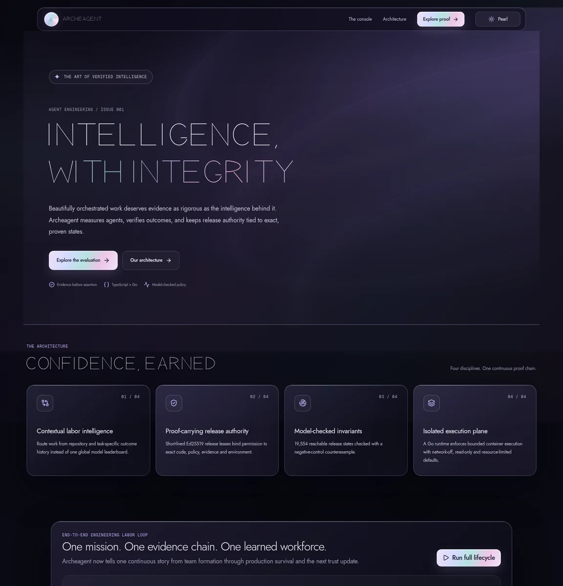
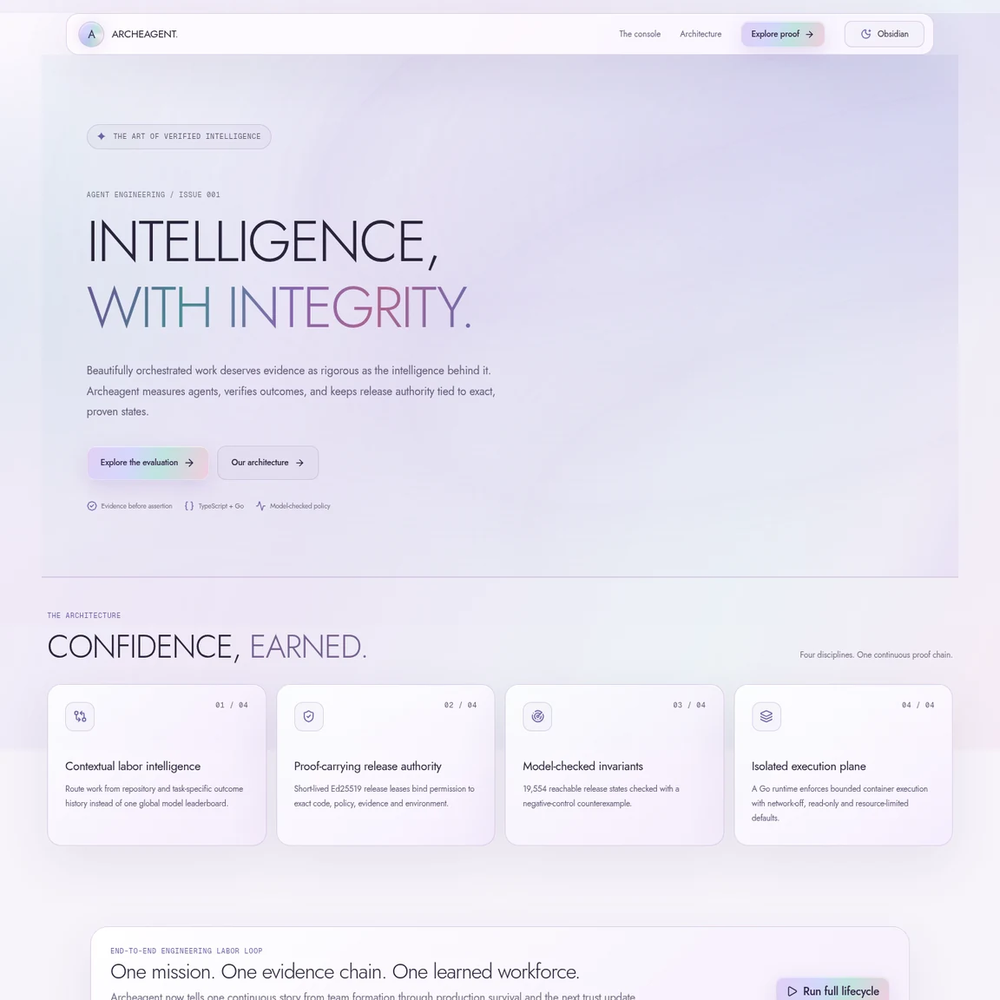
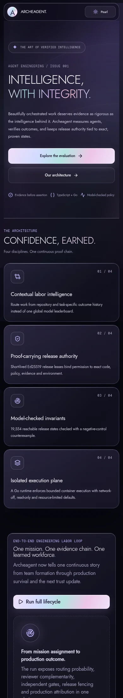
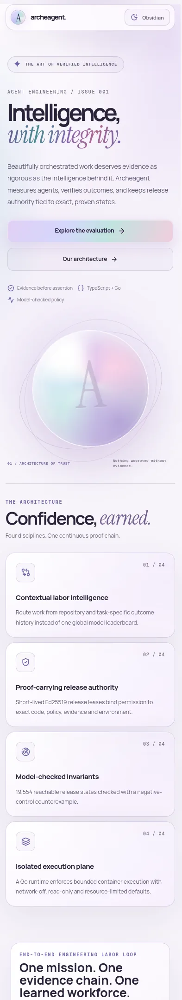

# Archeagent: holographic obsidian / mother of pearl

These previews were captured by Chromium from the actual working Next.js app
with the original Archeagent Line display typeface loaded. They are not
static UI mockups.

## Obsidian dark

## Mother-of-pearl light

## Mobile captures

| Dark | Light |
| --- | --- |
|  |  |

## Typography

Axuno is the reference display font chosen by the owner. No original licensed
Axuno Webfont binary has been supplied. We built an independent monoline
geometric display face, Archeagent Line, from original vector skeletons in
scripts/build-display-font.py, with a distinct split-bar A.

Archeagent Line is now loaded as a real self-hosted font in live CSS, not a
Jost display fallback, when Axuno is unavailable. Jost remains body/UI copy;
Geist Mono serves technical receipts.

## Browser verification

- Desktop 1440 px and mobile 390 px screenshots captured from the app.
- Real self-hosted custom font loaded and computed for the display stack.
- Dark/light switch persists across reload.
- No horizontal overflow, no page JavaScript exceptions.
- Evaluator interaction produces twelve lifecycle stages.
- No standalone pearl object; holographic material occupies the whole UI.
- Layout and console remain real React/Next.js, not rendered artwork.

The implementation is in a review branch, not merged into main.
